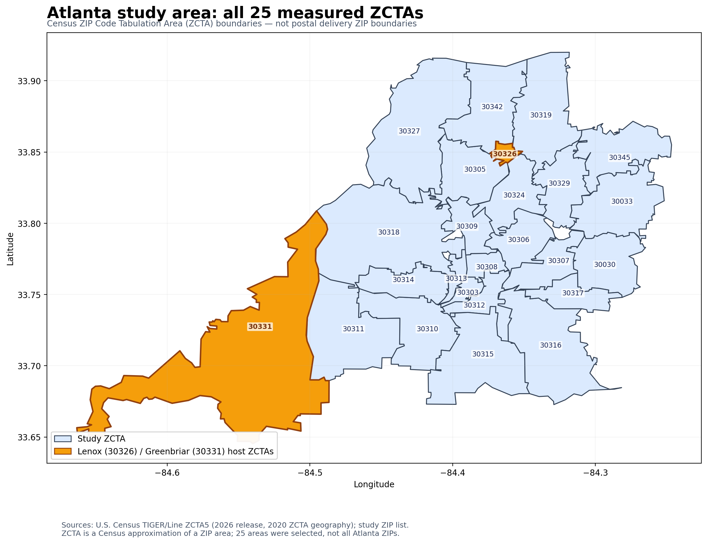
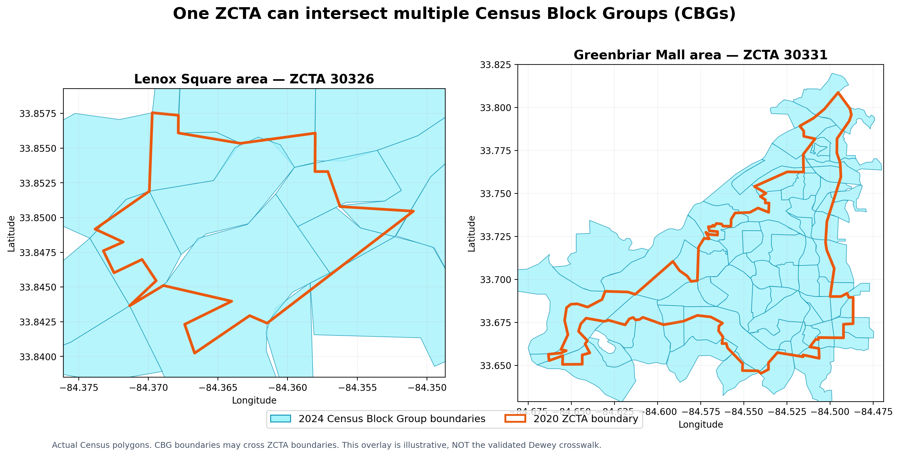

# Atlanta Retail Mobility & Neighborhood Inequality (ECON 499)

**An accessible, reproducible research walkthrough** of four Atlanta mall-area destinations in 2024, focusing on Lenox Square vs Greenbriar Mall.

## Maps: Atlanta study ZIP-like areas and CBGs

**New:** [`notebooks/06_atlanta_zcta_cbg_maps.ipynb`](notebooks/06_atlanta_zcta_cbg_maps.ipynb) and [`docs/MAPS_AND_GEOGRAPHY.md`](docs/MAPS_AND_GEOGRAPHY.md) show all 25 study areas, real ZCTA/CBG boundary differences, and the crosswalk formula. The simplified Census boundaries are included under `data/public_geography/` so maps run without private mobility data. ZIP and ZCTA are not identical.

## Research question
How are neighborhood income, inequality, community composition and driving distance associated with reported device activity in the census block groups containing Lenox Square, Phipps Plaza, Ponce City Market and Greenbriar Mall?

**Important:** This is a descriptive spatial-flow study, **not** a causal test of luxury consumption. Geographic harmonization is not finalized; all coefficients are **provisional**.

## New: Lenox vs Greenbriar neighborhood income context
The two mall-host ZCTAs differ substantially in 2024 ACS median household income. Read [`docs/NEIGHBORHOOD_COMPARISON.md`](docs/NEIGHBORHOOD_COMPARISON.md) and run [`notebooks/05_neighborhood_income_context.ipynb`](notebooks/05_neighborhood_income_context.ipynb). **Host ZCTA income is not visitor income**; provisional origin activity is analyzed separately.

## Start here
1. Read [`docs/METHODS_AND_FORMULAS.md`](docs/METHODS_AND_FORMULAS.md) for the complete plain-language study and equations.
2. Read [`docs/VARIABLE_DICTIONARY.md`](docs/VARIABLE_DICTIONARY.md) for every variable.
3. Read [`docs/LITERATURE_REVIEW.md`](docs/LITERATURE_REVIEW.md) for peer-reviewed inspiration and a presentation script.
4. Run the numbered notebooks in [`notebooks/`](notebooks/) using Jupyter or Colab.
5. See [`results/tables/`](results/tables/) and [`results/figures/`](results/figures/) for **previously produced** diagnostic outputs. Re-running may produce different values if dependencies, geographic inputs, or model samples differ.

## Data preparation and reproducibility
Place the **original licensed input files** in `data/private/` (ignored by Git). The notebooks expect the 2024 Dewey extraction ZIP, ACS CSV, 100-distance workbook, and the two provisional crosswalk CSVs from the earlier project package. Crosswalk construction itself was originally implemented in `scripts/original_run_models.py`; that archived script has absolute `/mnt/data` paths and is **not portable without editing**. Notebook 01 validates and merges existing crosswalks rather than silently rebuilding them.

Install: `pip install -r requirements.txt`. Run notebooks 00 → 01 → 02 → 03 → 04.

## Data rights
**Do not upload raw Dewey data or derived origin-level flows to public GitHub unless the data license explicitly permits it.** The provided GitHub package excludes raw Dewey data and individual ZCTA panels; the `.gitignore` excludes private and processed data. Check ACS and map licensing and attribution too.

## Research status
The analysis is assembled and documented, **but final geographic validation remains unresolved**. Specifically, verify the vendor's source-CBG vintage and origin suppression/reporting rules before treating the regression estimates as definitive. The historical data cannot identify before/after mall construction effects.

## Original project and additions
The initial project concerned Buckhead retail, socioeconomic inequality and conspicuous consumption. The revised empirical scope includes Ponce and Greenbriar, year-round device-origin activity, geographic matching, four-destination PPML, Lenox–Greenbriar comparison, robustness, and holdout evaluation. Conspicuous consumption remains **motivation**, not a tested purchasing outcome.
