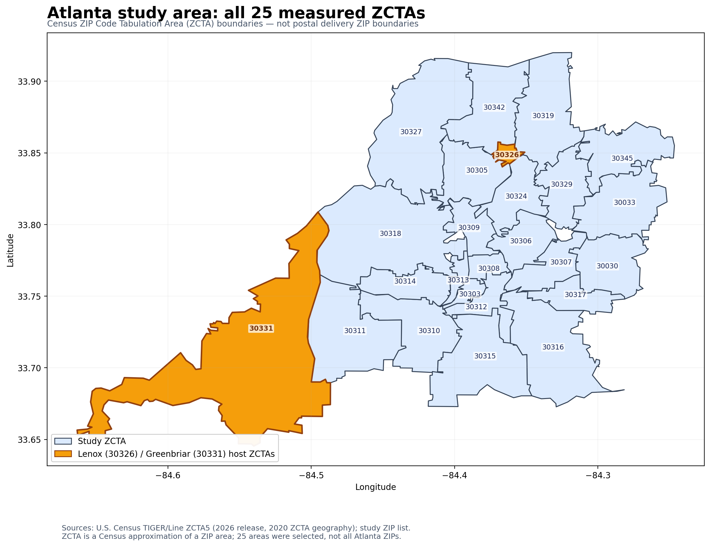
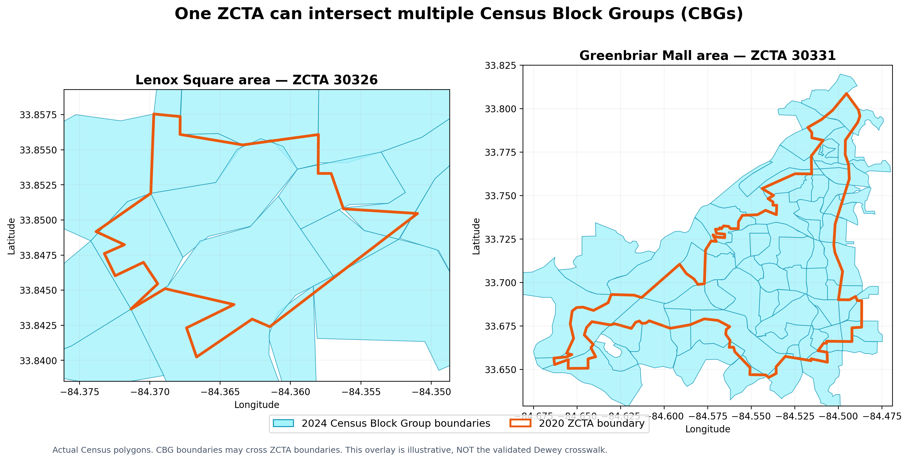
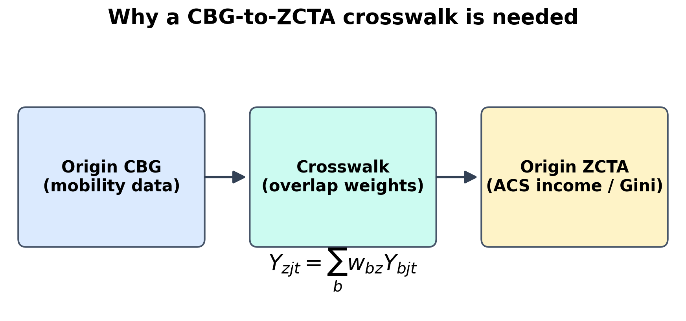

# Atlanta study geography: 25 ZCTAs and Census Block Groups

## Figure 1: Study area

The 25 blue/orange polygons are the **exact Census ZCTA boundaries** for the 25 areas used as study origins. Orange highlights the **host ZCTAs** used to describe the Lenox (30326) and Greenbriar (30331) socioeconomic contexts. These are not all ZIP codes in Atlanta, nor postal ZIP delivery boundaries.

## Figure 2: Why ZIP/ZCTA and CBG are different

- **ZIP code:** USPS mail-routing geography, not necessarily a stable polygon.
- **ZCTA:** Census-defined geographic approximation to ZIP areas; this is the geography used for the ACS socioeconomic data.
- **CBG:** Census Block Group, smaller than a ZCTA and nested in a Census tract, used as the reported home-area geography in the mobility extraction.
- A ZCTA may intersect **many CBGs**, and a CBG can cross a ZCTA boundary. Consequently, we cannot merge a CBG ID with a ZIP/ZCTA ID directly.

## Figure 3: How the crosswalk works

$$Y_{zjt}=\sum_b w_{bz}Y_{bjt}$$

The geographic weights are needed to allocate reported CBG-origin activity to ZCTAs for comparison with ACS data. **The figures are explanatory and do not validate the project’s provisional crosswalks.**

## Sources and reproducibility

- [U.S. Census TIGER/Line 2026 ZCTA5, 2020 ZCTA definitions](https://www.census.gov/geographies/mapping-files/time-series/geo/tiger-line-file.html) (source file `tl_2026_us_zcta520.zip`).
- [U.S. Census TIGER/Line 2024 Georgia Block Groups](https://www.census.gov/geographies/mapping-files/time-series/geo/tiger-line-file.html) (source file `tl_2024_13_bg.zip`).
- Public simplified geographic extracts are stored in `data/public_geography/`. Notebook `06_atlanta_zcta_cbg_maps.ipynb` reproduces the visualizations without proprietary mobility data.
- ZCTA polygons use 2020 definitions as labeled in the 2026 Census release. CBG geometry uses 2024 TIGER/Line. This **does not establish the vintage of Dewey/Advan source-CBG codes**.
- The host-ZCTA comparison is not an equal-distance (e.g., three-mile) trade-area comparison.
